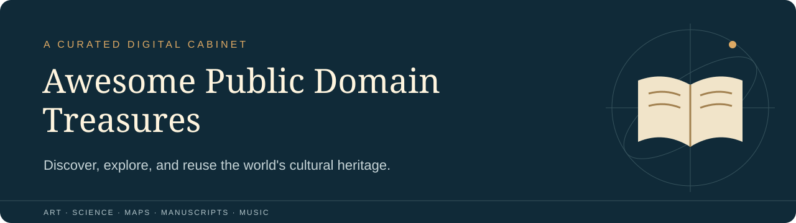

# Awesome Public Domain Treasures



**Discover, explore, and reuse the world's cultural heritage.**

A cabinet of extraordinary things you can actually investigate: a Yemeni astrolabe, a Tunisian Qur’an folio, a mathematical tablet, an illustrated atlas of the heavens, and literature that changed how people described their lives. Follow the links to the institutions caring for them.

This first edition brings together **68 individually researched treasures in 12 categories**. It prioritizes particular works and objects over archive homepages. Dates and attributions follow the linked records; approximate dates remain approximate. Some manuscript records show selected openings rather than complete books.

> **Check rights before reuse.** Public-domain assessments differ by jurisdiction and asset. CC0, an institutional Public Domain Mark and a United States-only copyright statement have different scopes. Each entry links to evidence; the Met’s eligible images additionally fall under its CC0 policy. Read [Copyright and rights](COPYRIGHT_AND_RIGHTS.md). This catalogue is not legal advice.

[Browse the interactive catalogue](index.html). Curated by Melvin Varghese.

## Explore

- [Start with something extraordinary](#start-with-something-extraordinary)
- [Rare Books & Manuscripts](#rare-books--manuscripts)
- [Historical Maps & Atlases](#historical-maps--atlases)
- [Astronomy & Celestial Charts](#astronomy--celestial-charts)
- [Botanical & Zoological Illustrations](#botanical--zoological-illustrations)
- [Scientific Discoveries & Publications](#scientific-discoveries--publications)
- [Art, Prints & Illustrations](#art-prints--illustrations)
- [Historical Photography](#historical-photography)
- [Literature & Poetry](#literature--poetry)
- [Music & Musical Scores](#music--musical-scores)
- [Engineering, Inventions & Technical Drawings](#engineering-inventions--technical-drawings)
- [Ancient Civilizations & Historical Documents](#ancient-civilizations--historical-documents)
- [Unusual & Forgotten Treasures](#unusual--forgotten-treasures)
- [Exceptional archives](#exceptional-archives)
- [Reuse with care](#reuse-with-care)
- [Contribute and maintain](#contribute-and-maintain)
- [Research and quality](#research-and-quality)
- [Acknowledgments and license](#acknowledgments-and-license)

## Start with something extraordinary

| If you enjoy… | Try this | Look for… |
| --- | --- | --- |
| Instruments that make the sky tangible | [A Yemeni astrolabe, 1291](#met-444408) | The relationship between a physical instrument and astronomical calculation. |
| Whole worlds on a page | [Harmonia macrocosmica](#cellarius-harmonia-1661) | Diagrams that turn competing cosmic systems into visual arguments. |
| Engineering before electricity | [Ramelli’s machines](#ramelli-machines-1588) | Mechanical solutions drawn as intricate arrangements of wheels and linkages. |
| Ocean imagery | [Hokusai’s Great Wave](#met-45434) | The small boats and distant mountain inside the wave’s enormous frame. |
| South Asian poetry | [Gitanjali](#pg-7164) | Tagore’s English song offerings; inspect the specific text and its US rights notice. |
| Unexpected ancient design | [A bowl with human feet](#met-547212) | An ordinary vessel transformed by two improbable supports. |

<!-- BEGIN GENERATED CATALOGUE -->

## Rare Books & Manuscripts

<a id="met-451683"></a>
**[Bifolium from a Qur'an Manuscript](https://www.metmuseum.org/art/collection/search/451683)** — Creator unrecorded; 15th century. A Qur'an bifolium combines Arabic text with diagonally arranged Persian translations, framed by colorful calligraphy and ornament.  
*Collection:* The Metropolitan Museum of Art · *Rights:* Public Domain · [Rights evidence](https://collectionapi.metmuseum.org/public/collection/v1/objects/451683)  
*Access:* JPEG

<a id="met-456074"></a>
**[Bifolium from the "Nurse's Qur'an" (Mushaf al-Hadina)](https://www.metmuseum.org/art/collection/search/456074)** — Creator unrecorded; ca. 410 AH/1019–20 CE. A parchment bifolium preserves a portion of the manuscript known as the Nurse's Qur'an, a striking example of medieval North African book arts.  
*Collection:* The Metropolitan Museum of Art · *Rights:* Public Domain · [Rights evidence](https://collectionapi.metmuseum.org/public/collection/v1/objects/456074)  
*Access:* JPEG

<a id="met-468941"></a>
**[Book of Hours](https://www.metmuseum.org/art/collection/search/468941)** — Gilles Hardouyn (publisher); Germain Hardouyn (artist); 1518–21. A Book of Hours joins printed illustration and hand illumination, revealing a meeting point between manuscript craft and early book production.  
*Collection:* The Metropolitan Museum of Art · *Rights:* Public Domain · [Rights evidence](https://collectionapi.metmuseum.org/public/collection/v1/objects/468941)  
*Access:* JPEG

<a id="met-684184"></a>
**[Book of Hours](https://www.metmuseum.org/art/collection/search/684184)** — Simon Bening; ca. 1530–35. Simon Bening compresses an illuminated devotional world into a tiny parchment book; the record offers images of selected openings.  
*Collection:* The Metropolitan Museum of Art · *Rights:* Public Domain · [Rights evidence](https://collectionapi.metmuseum.org/public/collection/v1/objects/684184)  
*Access:* JPEG

<a id="met-320635"></a>
**[Tälsäm or yä bərana kətab (healing scroll)](https://www.metmuseum.org/art/collection/search/320635)** — Creator unrecorded; 19th century. Written prayers and painted talismans share a long parchment healing scroll, documenting a distinctive Ethiopian devotional tradition.  
*Collection:* The Metropolitan Museum of Art · *Rights:* Public Domain · [Rights evidence](https://collectionapi.metmuseum.org/public/collection/v1/objects/320635)  
*Access:* JPEG


## Historical Maps & Atlases

<a id="brion-africa-1786"></a>
**[Africa, prepared for the study of geography](https://digitalcollections.library.tamu.edu/do/e93eea73-e10a-4581-8766-86ae97b1aa8b)** — Louis Brion de la Tour; Louis-Charles Desnos; Possibly 1786. A hand-colored teaching map with a decorative border, useful for examining the presentation of Africa in eighteenth-century European atlases.  
*Collection:* Texas A&M University Libraries · *Rights:* Public Domain — United States · [Rights evidence](https://digitalcollections.library.tamu.edu/do/e93eea73-e10a-4581-8766-86ae97b1aa8b)  
*Access:* TIFF, IIIF

<a id="official-war-maps-1898"></a>
**[Official war maps: Cuba and the West Indies](https://digitalcollections.library.tamu.edu/do/4bb167b9-3bd6-400a-a0c6-690beeac8667)** — Rand McNally and Company (publisher); 1898. A folding commercial map publication documenting how Cuba and the Caribbean were presented to readers during the Spanish-American War.  
*Collection:* Texas A&M University Libraries · *Rights:* Public Domain — United States · [Rights evidence](https://digitalcollections.library.tamu.edu/do/4bb167b9-3bd6-400a-a0c6-690beeac8667)  
*Access:* TIFF, IIIF

<a id="speed-kingdome-china"></a>
**[The kingdome of China](https://digitalcollections.library.tamu.edu/do/8b54f836-f9f2-43f7-8eda-0d2b89ca6f5d)** — John Speed; 1626. A map framed by figures and city views; its depiction of Korea as an island reveals the limits of contemporary European cartography.  
*Collection:* Texas A&M University Libraries · *Rights:* Public Domain — United States · [Rights evidence](https://digitalcollections.library.tamu.edu/do/8b54f836-f9f2-43f7-8eda-0d2b89ca6f5d)  
*Access:* TIFF, IIIF

<a id="ortelius-theatrum-1570"></a>
**[Theatrum orbis terrarum](https://www.e-rara.ch/zuz/content/titleinfo/23011918)** — Abraham Ortelius; Franz Hogenberg; 1570. A colored atlas whose sequence of maps lets readers compare sixteenth-century representations of different parts of the world.  
*Collection:* Zentralbibliothek Zürich / e-rara · *Rights:* Public Domain · [Rights evidence](https://www.e-rara.ch/zuz/content/titleinfo/23011918)  
*Access:* IIIF


## Astronomy & Celestial Charts

<a id="met-444408"></a>
**[Astrolabe of ‘Umar ibn Yusuf ibn ‘Umar ibn ‘Ali ibn Rasul al-Muzaffari](https://www.metmuseum.org/art/collection/search/444408)** — ‘Umar ibn Yusuf ibn ‘Umar ibn ‘Ali ibn Rasul al-Muzaffari; dated 690 AH/1291 CE. A dated Yemeni astrolabe turns celestial calculation into a finely worked brass instrument with silver inlay.  
*Collection:* The Metropolitan Museum of Art · *Rights:* Public Domain · [Rights evidence](https://collectionapi.metmuseum.org/public/collection/v1/objects/444408)  
*Access:* JPEG

<a id="ferguson-astronomy-1794"></a>
**[Astronomy explained upon Sir Isaac Newton’s principles](https://content.www.wellcomecollection.org/works/cbn45tvd)** — James Ferguson; 1794. The ninth edition of an illustrated astronomy textbook, offering a route into the diagrams and explanations used to teach Newtonian astronomy.  
*Collection:* Wellcome Collection · *Rights:* Public Domain · [Rights evidence](https://content.www.wellcomecollection.org/works/cbn45tvd)  
*Access:* See the institutional record for available formats.

<a id="cellarius-harmonia-1661"></a>
**[Harmonia macrocosmica](https://www.e-rara.ch/zuz/content/titleinfo/25530248)** — Andreas Cellarius; 1661. A colored celestial atlas presenting competing constructions of the cosmos alongside representations of the starry heavens.  
*Collection:* Zentralbibliothek Zürich / e-rara · *Rights:* Public Domain · [Rights evidence](https://www.e-rara.ch/zuz/content/titleinfo/25530248)  
*Access:* IIIF

<a id="met-451699"></a>
**[Planispheric Astrolabe](https://www.metmuseum.org/art/collection/search/451699)** — Muhammad Zaman al-Munajjim al-Asturlabi; dated 1065 AH/1654–55 CE. A pierced and engraved brass-and-steel astrolabe unites timekeeping with elaborate Safavid-period metalwork.  
*Collection:* The Metropolitan Museum of Art · *Rights:* Public Domain · [Rights evidence](https://collectionapi.metmuseum.org/public/collection/v1/objects/451699)  
*Access:* JPEG

<a id="galileo-sidereus-1610"></a>
**[Sidereus nuncius](https://www.e-rara.ch/zut/content/titleinfo/227751)** — Galileo Galilei; 1610. Galileo’s telescopic observations turn the Moon, stars, and the bodies orbiting Jupiter into evidence readers can inspect in an early printed report.  
*Collection:* ETH-Bibliothek Zürich / e-rara · *Rights:* Public Domain · [Rights evidence](https://www.e-rara.ch/zut/content/titleinfo/227751)  
*Access:* IIIF

<a id="bayer-uranometria-1603"></a>
**[Uranometria](https://www.e-rara.ch/zut/content/titleinfo/77412)** — Johann Bayer; Alexander Mair; 1603. An engraved star atlas joining constellation figures to mapped stars, ideal for exploring the visual language of early modern astronomy.  
*Collection:* ETH-Bibliothek Zürich / e-rara · *Rights:* Public Domain · [Rights evidence](https://www.e-rara.ch/zut/content/titleinfo/77412)  
*Access:* IIIF


## Botanical & Zoological Illustrations

<a id="mackintosh-birds-darjeeling"></a>
**[Birds of Darjeeling and India](https://www.biodiversitylibrary.org/item/50146)** — L. J. Mackintosh; 1915. A locally printed bird book with illustrations and indexes, offering a historical view of ornithological publishing in Calcutta.  
*Collection:* Smithsonian Libraries and Archives / Biodiversity Heritage Library · *Rights:* Public Domain · [Rights evidence](https://www.biodiversitylibrary.org/item/50146)  
*Access:* PDF, JPEG 2000, Text

<a id="finn-garden-birds-india"></a>
**[Garden and aviary birds of India](https://www.biodiversitylibrary.org/item/47645)** — Frank Finn; 1906. An illustrated Calcutta publication on birds in gardens and aviaries, with plates and an index that support browsing across species.  
*Collection:* Smithsonian Libraries and Archives / Biodiversity Heritage Library · *Rights:* Public Domain · [Rights evidence](https://www.biodiversitylibrary.org/item/47645)  
*Access:* PDF, JPEG 2000, Text

<a id="haeckel-kunstformen"></a>
**[Kunstformen der Natur](https://www.e-rara.ch/zut/doi/10.3931/e-rara-59154)** — Ernst Haeckel; 1899–1904. Two volumes of illustrated natural forms invite close comparison of biological structures and the visual patterns used to present them.  
*Collection:* ETH-Bibliothek Zürich / e-rara · *Rights:* Public Domain · [Rights evidence](https://www.e-rara.ch/zut/doi/10.3931/e-rara-59154)  
*Access:* IIIF

<a id="rousseau-redoute-botanique"></a>
**[La botanique de J.-J. Rousseau](https://www.e-rara.ch/gep_r/content/titleinfo/21234728)** — Jean-Jacques Rousseau; Pierre-Joseph Redouté; 1805. Botanical letters and fragments accompanied by 65 color-printed plates after Redouté, bringing descriptive prose and plant illustration together.  
*Collection:* Bibliothèque de Genève / e-rara · *Rights:* Public Domain · [Rights evidence](https://www.e-rara.ch/gep_r/content/titleinfo/21234728)  
*Access:* IIIF


## Scientific Discoveries & Publications

<a id="met-322022"></a>
**[Cuneiform tablet: fragment of a mathematical problem text](https://www.metmuseum.org/art/collection/search/322022)** — Creator unrecorded; ca. late 1st millennium BCE. A fragmentary clay tablet carries a mathematical problem text, linking the history of calculation with the physical practice of writing.  
*Collection:* The Metropolitan Museum of Art · *Rights:* Public Domain · [Rights evidence](https://collectionapi.metmuseum.org/public/collection/v1/objects/322022)  
*Access:* JPEG

<a id="hooke-micrographia-1665"></a>
**[Micrographia](https://content.www.wellcomecollection.org/works/apmaw56u)** — Robert Hooke; 1665. An illustrated investigation of minute bodies seen through magnifying instruments, with folded engraved plates that reward close viewing.  
*Collection:* Wellcome Collection · *Rights:* Public Domain · [Rights evidence](https://content.www.wellcomecollection.org/works/apmaw56u)  
*Access:* See the institutional record for available formats.

<a id="buonanni-micrographia-1691"></a>
**[Observationes circa viventia, with Micrographia curiosa](https://www.e-rara.ch/zut/content/titleinfo/5973934)** — Filippo Buonanni; 1691. A seventeenth-century volume of observations on living things and microscopic subjects, accompanied by 70 plates.  
*Collection:* ETH-Bibliothek Zürich / e-rara · *Rights:* Public Domain · [Rights evidence](https://www.e-rara.ch/zut/content/titleinfo/5973934)  
*Access:* IIIF

<a id="darwin-origin-1859"></a>
**[On the origin of species](https://wellcomecollection.org/works/ytv5whr6)** — Charles Darwin; 1859. A digitized first-edition copy of Darwin’s argument for natural selection; the record identifies details associated with the earliest issue.  
*Collection:* Wellcome Collection · *Rights:* Public Domain · [Rights evidence](https://wellcomecollection.org/works/ytv5whr6)  
*Access:* See the institutional record for available formats.

<a id="newton-principia-1687"></a>
**[Philosophiae naturalis principia mathematica](https://wellcomecollection.org/works/bhkrk934)** — Isaac Newton; 1687. The first issue of the first edition, with geometrical diagrams that let readers follow the form of Newton’s mathematical arguments.  
*Collection:* Wellcome Collection · *Rights:* Public Domain · [Rights evidence](https://wellcomecollection.org/works/bhkrk934)  
*Access:* See the institutional record for available formats.


## Art, Prints & Illustrations

<a id="met-451270"></a>
**["Shah Jahan on a Terrace, Holding a Pendant Set With His Portrait", Folio from the Shah Jahan Album](https://www.metmuseum.org/art/collection/search/451270)** — Chitarman; recto: dated 1627–28; verso: ca. 1530–50. An imperial portrait places Shah Jahan on a terrace surrounded by carefully rendered signs of rank and courtly craftsmanship.  
*Collection:* The Metropolitan Museum of Art · *Rights:* Public Domain · [Rights evidence](https://collectionapi.metmuseum.org/public/collection/v1/objects/451270)  
*Access:* JPEG

<a id="met-436121"></a>
**[A Woman Seated beside a Vase of Flowers (Madame Paul Valpinçon?)](https://www.metmuseum.org/art/collection/search/436121)** — Edgar Degas; 1865. Degas sets a seated woman beside a substantial arrangement of flowers; even the sitter identification remains a question in the catalog.  
*Collection:* The Metropolitan Museum of Art · *Rights:* Public Domain · [Rights evidence](https://collectionapi.metmuseum.org/public/collection/v1/objects/436121)  
*Access:* JPEG

<a id="met-437980"></a>
**[Cypresses](https://www.metmuseum.org/art/collection/search/437980)** — Vincent van Gogh; 1889. Van Gogh makes cypress trees the subject of an oil painting, inviting close study of how paint builds a landscape.  
*Collection:* The Metropolitan Museum of Art · *Rights:* Public Domain · [Rights evidence](https://collectionapi.metmuseum.org/public/collection/v1/objects/437980)  
*Access:* JPEG

<a id="met-312289"></a>
**[Equestrian](https://www.metmuseum.org/art/collection/search/312289)** — Dogon blacksmith; 16th–18th century. A carved rider and horse form a dynamic sculpture whose gestures link leadership, defense, and the prestige of equestrian imagery.  
*Collection:* The Metropolitan Museum of Art · *Rights:* Public Domain · [Rights evidence](https://collectionapi.metmuseum.org/public/collection/v1/objects/312289)  
*Access:* JPEG

<a id="met-51359"></a>
**[Maebyeong](https://www.metmuseum.org/art/collection/search/51359)** — Creator unrecorded; 12th century. Peonies and floral scrolls decorate a Goryeo celadon bottle, bringing bold iron-brown painting beneath a green glaze.  
*Collection:* The Metropolitan Museum of Art · *Rights:* Public Domain · [Rights evidence](https://collectionapi.metmuseum.org/public/collection/v1/objects/51359)  
*Access:* JPEG

<a id="met-449537"></a>
**[Mihrab (Prayer Niche)](https://www.metmuseum.org/art/collection/search/449537)** — Creator unrecorded; dated 755 AH/1354–55 CE. Cut glazed tiles assemble calligraphy and ornament into a monumental prayer niche from Isfahan.  
*Collection:* The Metropolitan Museum of Art · *Rights:* Public Domain · [Rights evidence](https://collectionapi.metmuseum.org/public/collection/v1/objects/449537)  
*Access:* JPEG

<a id="met-39901"></a>
**[Night-Shining White](https://www.metmuseum.org/art/collection/search/39901)** — Han Gan; ca. 750. Han Gan renders a horse in ink on a handscroll, a compact work whose mounted form also carries later inscriptions and collectors marks.  
*Collection:* The Metropolitan Museum of Art · *Rights:* Public Domain · [Rights evidence](https://collectionapi.metmuseum.org/public/collection/v1/objects/39901)  
*Access:* JPEG

<a id="met-316487"></a>
**[Plaque with Two Fluted Gourds](https://www.metmuseum.org/art/collection/search/316487)** — Ìgùn Ẹ́rọ̀nwwọ̀n (brass-casting guild) artists; ca. 1540–70. A cast-brass palace plaque turns paired gourds into a study of symmetry, surface pattern, and the visual language of the Benin court.  
*Collection:* The Metropolitan Museum of Art · *Rights:* Public Domain · [Rights evidence](https://collectionapi.metmuseum.org/public/collection/v1/objects/316487)  
*Access:* JPEG

<a id="met-39328"></a>
**[Shiva as Lord of Dance (Nataraja)](https://www.metmuseum.org/art/collection/search/39328)** — Creator unrecorded; ca. late 11th century. Shiva dances inside a flaming circle in a Chola-period copper-alloy sculpture that brings movement and cosmology into a single balanced form.  
*Collection:* The Metropolitan Museum of Art · *Rights:* Public Domain · [Rights evidence](https://collectionapi.metmuseum.org/public/collection/v1/objects/39328)  
*Access:* JPEG

<a id="met-435882"></a>
**[Still Life with Apples and a Pot of Primroses](https://www.metmuseum.org/art/collection/search/435882)** — Paul Cézanne; ca. 1890. Apples and a flowering pot make a compact still life for studying arrangement, mass, and the painted surface.  
*Collection:* The Metropolitan Museum of Art · *Rights:* Public Domain · [Rights evidence](https://collectionapi.metmuseum.org/public/collection/v1/objects/435882)  
*Access:* JPEG

<a id="met-45434"></a>
**[Under the Wave off Kanagawa (Kanagawa oki nami ura), also known as The Great Wave, from the series Thirty-six Views of Mount Fuji (Fugaku sanjūrokkei)](https://www.metmuseum.org/art/collection/search/45434)** — Katsushika Hokusai; ca. 1830–32. A curling wave frames distant Mount Fuji in a woodblock print whose scale turns small boats into a drama of water and sky.  
*Collection:* The Metropolitan Museum of Art · *Rights:* Public Domain · [Rights evidence](https://collectionapi.metmuseum.org/public/collection/v1/objects/45434)  
*Access:* JPEG

<a id="met-436535"></a>
**[Wheat Field with Cypresses](https://www.metmuseum.org/art/collection/search/436535)** — Vincent van Gogh; 1889. Fields and cypresses become a landscape of strongly articulated color and brushwork in this 1889 canvas.  
*Collection:* The Metropolitan Museum of Art · *Rights:* Public Domain · [Rights evidence](https://collectionapi.metmuseum.org/public/collection/v1/objects/436535)  
*Access:* JPEG


## Historical Photography

<a id="wellcome-jqc79fxf"></a>
**[A Japanese village in wooded country](https://wellcomecollection.org/works/jqc79fxf)** — William Pryor Floyd; c. 1873 (title attribution; catalogue date range 1800–1899). An albumen photograph places village architecture within a wooded landscape, preserving the spatial detail of a nineteenth-century view.  
*Collection:* Wellcome Collection · *Rights:* Public Domain · [Rights evidence](https://wellcomecollection.org/works/jqc79fxf)  
*Access:* JPEG

<a id="wellcome-dkrtdw9r"></a>
**[India: a field laboratory](https://wellcomecollection.org/works/dkrtdw9r)** — Creator unrecorded; 1900–1920 (?). Microscopes and white coats fill a rudimentary laboratory associated in the catalogue lettering with the Kala-Azar Commission in India.  
*Collection:* Wellcome Collection · *Rights:* Public Domain · [Rights evidence](https://wellcomecollection.org/works/dkrtdw9r)  
*Access:* JPEG

<a id="wellcome-frh8z3ap"></a>
**[Manchu ladies in a garden](https://wellcomecollection.org/works/frh8z3ap)** — John Thomson; 1981 print from an 1869 negative. Two women in embroidered clothing stand in a garden. The record carefully distinguishes the nineteenth-century negative from the later contact print.  
*Collection:* Wellcome Collection · *Rights:* Public Domain · [Rights evidence](https://wellcomecollection.org/works/frh8z3ap)  
*Access:* JPEG

<a id="wellcome-rt5ucask"></a>
**[Philae: temple buildings reflected in the Nile](https://wellcomecollection.org/works/rt5ucask)** — Antonio Beato; c. 1870. Temple buildings and reflections preserve Philae in its earlier setting, before the complex was relocated in the twentieth century.  
*Collection:* Wellcome Collection · *Rights:* Public Domain · [Rights evidence](https://wellcomecollection.org/works/rt5ucask)  
*Access:* JPEG

<a id="wellcome-wmm3pvmc"></a>
**[The Taj Mahal, Agra, India](https://wellcomecollection.org/works/wmm3pvmc)** — Creator unrecorded; c. 1900. An early photographic view of the Taj Mahal offers a historical counterpart to its familiar modern image.  
*Collection:* Wellcome Collection · *Rights:* Public Domain · [Rights evidence](https://wellcomecollection.org/works/wmm3pvmc)  
*Access:* JPEG


## Literature & Poetry

<a id="pg-873"></a>
**[A House of Pomegranates](https://www.gutenberg.org/ebooks/873)** — Oscar Wilde; 1915 (linked Methuen edition). Four elaborate fairy tales explore beauty and suffering, from a young king's costly robes to a fisherman's bargain for love.  
*Collection:* Project Gutenberg · *Rights:* Public Domain — United States · [Rights evidence](https://www.gutenberg.org/cache/epub/873/pg873-images.html)  
*Access:* HTML, EPUB, Plain text

<a id="pg-2046"></a>
**[Clotel; Or, The President's Daughter](https://www.gutenberg.org/ebooks/2046)** — William Wells Brown; 1853 (original publication). An abolitionist novel following a mother and daughters through the violence of enslavement, combining fiction with a direct political appeal.  
*Collection:* Project Gutenberg · *Rights:* Public Domain — United States · [Rights evidence](https://www.gutenberg.org/cache/epub/2046/pg2046-images.html)  
*Access:* HTML, EPUB, Plain text

<a id="pg-7164"></a>
**[Gitanjali (Song Offerings)](https://www.gutenberg.org/ebooks/7164)** — Rabindranath Tagore; English translations by the author; introduction by W. B. Yeats; 1912 (English collection first published). Brief devotional prose poems carry Bengali verse into English in the poet's own translations. Read alongside Yeats's introductory account of their reception.  
*Collection:* Project Gutenberg · *Rights:* Public Domain — United States · [Rights evidence](https://www.gutenberg.org/cache/epub/7164/pg7164-images.html)  
*Access:* HTML, EPUB, Plain text

<a id="pg-11030"></a>
**[Incidents in the Life of a Slave Girl, Written by Herself](https://www.gutenberg.org/ebooks/11030)** — Harriet A. Jacobs; edited by Lydia Maria Child; 1861. An autobiographical account foregrounding motherhood, concealment, and resistance under slavery. The linked transcription includes Child's editorial introduction.  
*Collection:* Project Gutenberg · *Rights:* Public Domain — United States · [Rights evidence](https://www.gutenberg.org/cache/epub/11030/pg11030-images.html)  
*Access:* HTML, EPUB, Plain text

<a id="pg-47584"></a>
**[Noli me tángere: Novela Tagala](https://www.gutenberg.org/ebooks/47584)** — José Rizal; annotated by Ramón Sempau; 1902 (linked Spanish edition). Rizal's novel exposes colonial power through the return of Crisóstomo Ibarra to the Philippines. This Spanish edition includes Sempau's notes.  
*Collection:* Project Gutenberg · *Rights:* Public Domain — United States · [Rights evidence](https://www.gutenberg.org/cache/epub/47584/pg47584-images.html)  
*Access:* HTML, EPUB, Plain text

<a id="pg-15399"></a>
**[The Interesting Narrative of the Life of Olaudah Equiano](https://www.gutenberg.org/ebooks/15399)** — Olaudah Equiano; 1789 (original publication). A transatlantic life story joins maritime experience, spiritual autobiography, and an argument against the slave trade.  
*Collection:* Project Gutenberg · *Rights:* Public Domain — United States · [Rights evidence](https://www.gutenberg.org/cache/epub/15399/pg15399-images.html)  
*Access:* HTML, EPUB, Plain text

<a id="pg-58585"></a>
**[The Prophet](https://www.gutenberg.org/ebooks/58585)** — Kahlil Gibran; 1923. Farewell speeches on love, labour, joy, and death form a sequence of prose poems, accompanied in this edition by Gibran's own illustrations.  
*Collection:* Project Gutenberg · *Rights:* Public Domain — United States · [Rights evidence](https://www.gutenberg.org/cache/epub/58585/pg58585-images.html)  
*Access:* HTML, EPUB, Plain text

<a id="pg-246"></a>
**[The Rubaiyat of Omar Khayyam](https://www.gutenberg.org/ebooks/246)** — Omar Khayyam; English rendering by Edward FitzGerald; 1859 (first English edition); later fifth-edition text also included. Compare two versions of FitzGerald's English rendering of Persian quatrains; the differences invite close reading of translation as creative interpretation.  
*Collection:* Project Gutenberg · *Rights:* Public Domain — United States · [Rights evidence](https://www.gutenberg.org/cache/epub/246/pg246-images.html)  
*Access:* HTML, EPUB, Plain text

<a id="pg-408"></a>
**[The Souls of Black Folk](https://www.gutenberg.org/ebooks/408)** — W. E. B. Du Bois; 1903. Essays, personal narrative, and musical epigraphs examine emancipation and its aftermath, making the page a meeting place of history and lived experience.  
*Collection:* Project Gutenberg · *Rights:* Public Domain — United States · [Rights evidence](https://www.gutenberg.org/cache/epub/408/pg408-images.html)  
*Access:* HTML, EPUB, Plain text


## Music & Musical Scores

<a id="nypl-daisy-bell"></a>
**[Daisy Bell](https://old-digitalcollections.nypl.org/items/5e66b3e8-94d1-d471-e040-e00a180654d7)** — Harry Dacre; 1892. The bicycle song appears here in its historical score, preserving the printed source rather than rights in any later recording.  
*Collection:* New York Public Library · *Rights:* Public Domain — United States · [Rights evidence](https://old-digitalcollections.nypl.org/items/5e66b3e8-94d1-d471-e040-e00a180654d7)  
*Access:* Online page images

<a id="loc-score-2016785448"></a>
**[Everything is hunky dory down in honky tonky town](https://www.loc.gov/item/2016785448/)** — Harry Tierney; 1918. Six digitised pages preserve a number from Everything, offering a compact window into early twentieth-century musical theatre.  
*Collection:* Library of Congress · *Rights:* Public Domain — United States · [Rights evidence](https://www.loc.gov/item/2016785448/)  
*Access:* PDF, Images

<a id="loc-score-2016769215"></a>
**[In those rare days of long ago](https://www.loc.gov/item/2016769215/)** — Julius Adler; 1896. A theatre song from The Liberty Bell survives as a five-page score, ready for study of melody, accompaniment, and stage nostalgia.  
*Collection:* Library of Congress · *Rights:* Public Domain — United States · [Rights evidence](https://www.loc.gov/item/2016769215/)  
*Access:* PDF, Images

<a id="loc-score-2016790970"></a>
**[Jump back: Jump back ma honey, jump back](https://www.loc.gov/item/2016790970/)** — Will Marion Cook (composer); Paul Laurence Dunbar (lyricist); 1898. A surviving score from Clorindy brings together Cook's theatre music and Dunbar's words, preserving a collaboration between two African American artists.  
*Collection:* Library of Congress · *Rights:* Public Domain — United States · [Rights evidence](https://www.loc.gov/item/2016790970/)  
*Access:* PDF, Images

<a id="loc-score-2023852492"></a>
**[O Maria! Or, The Plumber's daughter](https://www.loc.gov/item/2023852492/)** — Chas. D. Blake; 1884. An unexpectedly titled nineteenth-century score provides a playful starting point for exploring the breadth of historical American sheet music.  
*Collection:* Library of Congress · *Rights:* Public Domain — United States · [Rights evidence](https://www.loc.gov/item/2023852492/)  
*Access:* PDF, Images


## Engineering, Inventions & Technical Drawings

<a id="farey-steam-engine-1827"></a>
**[A treatise on the steam engine](https://www.e-rara.ch/zut/content/titleinfo/18859705)** — John Farey; 1827. A detailed account joining the history and practical construction of steam engines, with illustrations and 25 plates.  
*Collection:* ETH-Bibliothek Zürich / e-rara · *Rights:* Public Domain · [Rights evidence](https://www.e-rara.ch/zut/content/titleinfo/18859705)  
*Access:* IIIF

<a id="ramelli-machines-1588"></a>
**[Le diverse et artificiose machine](https://www.e-rara.ch/zut/content/titleinfo/2562552)** — Agostino Ramelli; 1588. A bilingual Italian and French machine book with 195 copper engravings, offering an extended gallery of sixteenth-century mechanical imagination.  
*Collection:* ETH-Bibliothek Zürich / e-rara · *Rights:* Public Domain · [Rights evidence](https://www.e-rara.ch/zut/content/titleinfo/2562552)  
*Access:* IIIF

<a id="lardner-steam-engine-1840"></a>
**[The steam engine explained and illustrated](https://www.e-rara.ch/zut/content/titleinfo/14148092)** — Dionysius Lardner; 1840. This illustrated seventh edition connects steam-engine development with applications to navigation and railways and includes a memoir of Watt.  
*Collection:* ETH-Bibliothek Zürich / e-rara · *Rights:* Public Domain · [Rights evidence](https://www.e-rara.ch/zut/content/titleinfo/14148092)  
*Access:* IIIF

<a id="besson-theatrum-1578"></a>
**[Theatrum instrumentorum et machinarum](https://www.e-rara.ch/zut/content/titleinfo/29199351)** — Jacques Besson; François Béroalde de Verville; 1578. Sixty plates and explanatory text turn mechanical instruments and machines into a large-format illustrated survey.  
*Collection:* ETH-Bibliothek Zürich / e-rara · *Rights:* Public Domain · [Rights evidence](https://www.e-rara.ch/zut/content/titleinfo/29199351)  
*Access:* IIIF


## Ancient Civilizations & Historical Documents

<a id="met-318011"></a>
**[Figure: Equestrian](https://www.metmuseum.org/art/collection/search/318011)** — Middle Niger artist; 12th–16th century. A miniature copper-alloy rider and horse reveal the sculptural skill of a Middle Niger artist within an object only a few centimeters high.  
*Collection:* The Metropolitan Museum of Art · *Rights:* Public Domain · [Rights evidence](https://collectionapi.metmuseum.org/public/collection/v1/objects/318011)  
*Access:* JPEG

<a id="met-310524"></a>
**[Head Vessel](https://www.metmuseum.org/art/collection/search/310524)** — Creator unrecorded; 2nd–6th century. A ceramic vessel models a human head, bringing sculptural portraiture into the form of a container.  
*Collection:* The Metropolitan Museum of Art · *Rights:* Public Domain · [Rights evidence](https://collectionapi.metmuseum.org/public/collection/v1/objects/310524)  
*Access:* JPEG

<a id="met-322603"></a>
**[Molded plaque: king or a god carrying a mace](https://www.metmuseum.org/art/collection/search/322603)** — Creator unrecorded; ca. 2000–1700 BCE. A molded ceramic plaque depicts a mace-bearing royal or divine figure; the catalog preserves the uncertainty of that identification.  
*Collection:* The Metropolitan Museum of Art · *Rights:* Public Domain · [Rights evidence](https://collectionapi.metmuseum.org/public/collection/v1/objects/322603)  
*Access:* JPEG

<a id="met-547951"></a>
**[Portrait of the Boy Eutyches](https://www.metmuseum.org/art/collection/search/547951)** — Creator unrecorded; 100–150 CE. An encaustic portrait on wood preserves the face of Eutyches, offering a direct encounter with painting from Roman-period Egypt.  
*Collection:* The Metropolitan Museum of Art · *Rights:* Public Domain · [Rights evidence](https://collectionapi.metmuseum.org/public/collection/v1/objects/547951)  
*Access:* JPEG

<a id="met-310715"></a>
**[Small Yoke](https://www.metmuseum.org/art/collection/search/310715)** — Creator unrecorded; 12th–9th century BCE. A small stone yoke from Tlatilco offers an unfamiliar object form from early Mesoamerica without requiring a speculative identification of its use.  
*Collection:* The Metropolitan Museum of Art · *Rights:* Public Domain · [Rights evidence](https://collectionapi.metmuseum.org/public/collection/v1/objects/310715)  
*Access:* JPEG


## Unusual & Forgotten Treasures

<a id="met-547212"></a>
**[Bowl with Human Feet](https://www.metmuseum.org/art/collection/search/547212)** — Creator unrecorded; ca. 3700–3450 BCE. Human feet animate a red-polished pottery bowl, turning an everyday container into a memorable object from Predynastic Egypt.  
*Collection:* The Metropolitan Museum of Art · *Rights:* Public Domain · [Rights evidence](https://collectionapi.metmuseum.org/public/collection/v1/objects/547212)  
*Access:* JPEG

<a id="met-552202"></a>
**[Figurine of a hippo made for suspension](https://www.metmuseum.org/art/collection/search/552202)** — Creator unrecorded; ca. 3650–3100 BCE. A tiny pink-limestone hippopotamus was made to hang, giving a familiar animal an unexpectedly portable sculptural form.  
*Collection:* The Metropolitan Museum of Art · *Rights:* Public Domain · [Rights evidence](https://collectionapi.metmuseum.org/public/collection/v1/objects/552202)  
*Access:* JPEG

<a id="pg-769"></a>
**[The Book of Tea](https://www.gutenberg.org/ebooks/769)** — Kakuzo Okakura; 1906. A compact meditation on tea, architecture, and aesthetics that makes everyday practices a route into Japanese cultural history. Originally written in English.  
*Collection:* Project Gutenberg · *Rights:* Public Domain — United States · [Rights evidence](https://www.gutenberg.org/cache/epub/769/pg769-images.html)  
*Access:* HTML, EPUB, Plain text

<a id="met-61546"></a>
**[Yoke ornament in the shape of a deer](https://www.metmuseum.org/art/collection/search/61546)** — Creator unrecorded; 5th–4th century BCE. A bronze deer transforms a functional yoke ornament into a small animal sculpture from early China.  
*Collection:* The Metropolitan Museum of Art · *Rights:* Public Domain · [Rights evidence](https://collectionapi.metmuseum.org/public/collection/v1/objects/61546)  
*Access:* JPEG

<!-- END GENERATED CATALOGUE -->

## Exceptional archives

These are routes for further exploration, **not blanket rights approvals**. Check each new item, file and edition independently. Only the eligible subsets described below belong in this catalogue.

| Institution or platform | What to explore | Rights boundary |
| --- | --- | --- |
| [The Metropolitan Museum of Art](https://www.metmuseum.org/art/collection) | Art, manuscripts, instruments and material culture. | Confirm item-level Open Access eligibility; eligible images are covered by the [CC0 policy](https://www.metmuseum.org/policies/image-resources). |
| [e-rara](https://www.e-rara.ch/) | Digitized early books, celestial atlases and illustrated technical works. | Check the Public Domain Mark or other terms on each record. |
| [Wellcome Collection](https://wellcomecollection.org/) | Science, medicine and historical photographs. | Licenses vary; selected records here explicitly carry the Public Domain Mark. |
| [Biodiversity Heritage Library](https://www.biodiversitylibrary.org/) | Illustrated natural histories and scientific literature. | Read the item-specific Copyright & Usage section. |
| [Texas A&M University Libraries](https://digitalcollections.library.tamu.edu/) | Historical maps and documentary collections. | Some maps explicitly carry No Copyright — United States; that statement is jurisdiction-specific. |
| [Project Gutenberg](https://www.gutenberg.org/) | Literature, memoirs, essays and historical translations. | Check the catalogue and ebook notice. US public-domain status does not clear every country; trademark terms are separate. |
| [Library of Congress](https://www.loc.gov/) | Sheet music, maps, manuscripts and photographs. | Read each record’s Rights & Access section; the whole website is not public domain. |
| [New York Public Library Digital Collections](https://digitalcollections.nypl.org/) | Scores, prints, maps and visual history. | Verify each record’s declaration and geographic scope. |

## Reuse with care

1. Open the item and its rights evidence. Confirm that the evidence covers the version you want, including its photograph, translation, edition or recording.
2. Check the law relevant to your location and intended distribution. A US-only entry may need further clearance elsewhere, including in India.
3. Inspect the current access options. Formats listed here were advertised by the institution; this project did not test every downloadable payload. IIIF is an image-access framework, not a single file type.
4. Keep the record URL, creator, date, institution and rights evidence with your working files. Credit sources even when a license does not require it.
5. Consider cultural sensitivity, provenance, privacy and other rights. Public-domain status is not institutional endorsement.

See [COPYRIGHT_AND_RIGHTS.md](COPYRIGHT_AND_RIGHTS.md) for the distinctions and primary guidance.

## Contribute and maintain

Suggest one exceptional work through the issue form, with item-specific rights evidence and a short original description. Read [CONTRIBUTING.md](CONTRIBUTING.md), [EDITORIAL_GUIDELINES.md](EDITORIAL_GUIDELINES.md) and the [community code](CODE_OF_CONDUCT.md).

The structured catalogue is [data/treasures.json](data/treasures.json), described by [schema.json](data/schema.json). To refresh the generated entries and run offline checks:

```bash
python3 scripts/build_readme.py
python3 scripts/validate.py
python3 -m unittest discover -s scripts -p 'test_*.py'
```

The included GitHub Actions workflow runs structural checks on pushes to `main` and on pull requests. It does not run external requests or decide copyright status. To perform an optional reachability audit locally, run `python3 scripts/check_external_links.py`; it records redirects, HTTP failures, likely bot protection and rate limits without deleting entries.

Maintainers should review link reports quarterly and revisit rights evidence annually, recording changes in [CHANGELOG.md](CHANGELOG.md). These are recommended duties for the future maintainer, not a promise of an operating service. See [GETTING_STARTED.md](GETTING_STARTED.md) for local setup. A scheduled **Link audit** workflow runs the reachability check each quarter and attaches its report to the run.

## Research and quality

Verification date: **30 October 2026**. This release deliberately stops at 68 researched entries rather than filling the 100–150 target with weaker candidates. It is a starting collection, not a representative survey of world heritage. The art selection relies heavily on the Met; early science remains European-heavy, and Oceania is absent. The records distinguish cultural origin from the place an object is held and from the subject a map depicts.

Read the [quality report](docs/QA_REPORT.md) and primary-source notes for [art and material culture](docs/research-art.md), [science and engineering](docs/research-science.md), and [literature, photography and music](docs/research-text.md). The [link audit](docs/link-audit.json) records independent automated access outcomes, including blocks; those results do not override research evidence or prove that a file is usable. Four music records initially required indexed official text; a final direct retrieval succeeded for all four and confirmed public-domain text. The research note preserves both stages.

## Acknowledgments and license

Thanks to the institutions, cataloguers, digitization teams and open-access advocates who make these materials discoverable. Descriptions here are original; titles, dates and attributions are grounded in the cited records. This independent project is not affiliated with or endorsed by the hosting institutions.

The project’s original writing, code, data arrangement and banner are distributed under the [MIT license](LICENSE). Linked works and third-party reproductions retain their own rights; the project license does not relicense them. No heritage image, book scan, score or recording is bundled in this repository.
